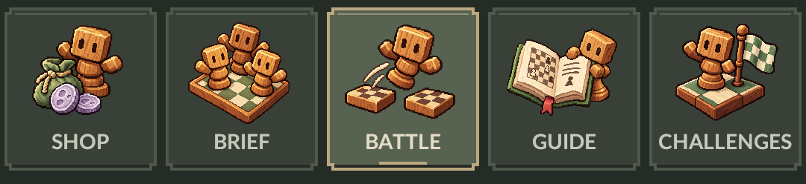

# Navegación con piezas de madera

Los cinco botones usan figuritas inspiradas en las piezas de Kayon, pequeños tableros y una paleta de madera, verde salvia y crema. La selección se señala con un fondo más claro, borde y subrayado discretos.

| Sección | Icono |
| --- | --- |
| Tienda | Figurita, bolsa y monedas lunares |
| Brief | Tres piezas reunidas en un tablero |
| Batalla | Pieza saltando entre dos campos |
| Guía | Libro abierto con diagrama de ajedrez |
| Desafíos | Pieza junto a una bandera a cuadros |

## Archivos

- Ilustraciones: `Assets/resources/MonsterPouch/UI/BoardMenu/`.
- Estilo y botones: `Assets/scripts/local/BoardMenuFace.cs`.
- Integración: `RenderNavigation()` en `Assets/scripts/local/local-game-menu.cs`.
- Herramienta de generación: ImageGen integrado; referencias y prompts completos en [image-prompts.json](image-prompts.json).
- Copia previa del menú: `Backups/board-navigation-20261015-170611/`.

## Comprobación visual

Se revisaron las cinco selecciones, la barra de 360 píxeles de ancho y las etiquetas en inglés y español. Las imágenes tienen transparencia, márgenes sin recortes y se importan como sprites individuales, sin compresión ni mipmaps y con filtro Point. Los iconos y textos no interceptan el toque del botón.

Las capturas se reproducen con `MonsterPouchBoardMenuPreview.Capture()` y la importación con `MonsterPouchBoardMenuImport.Apply()` mediante el puente local del editor.

Cuatro pruebas Play Mode completadas el 15 de octubre de 2026: **4 aprobadas, 0 fallidas**. Comprueban las secciones de tienda y desafíos, el área segura y los gestos de navegación, incluido invertir el arrastre antes de soltar. Resultados en [navigation-tests.xml](navigation-tests.xml).

La barra también se comprobó dentro de la escena en ejecución a 1080 × 2340; captura en [navigation-in-game.png](navigation-in-game.png).
