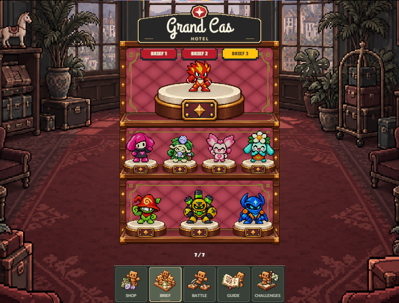

# Estante visible después de deslizar

Al confirmar un deslizamiento, la navegación traslada los hijos de la vista previa a la página principal y destruye el contenedor temporal. El componente que poseía los materiales del estante estaba en ese contenedor: su destrucción liberaba los materiales que todavía usaban las baldas, los soportes, las bases y el revestimiento.

La paleta ahora pertenece a un hijo de la página que se traslada junto con las piezas. Así conserva los materiales al confirmar o interrumpir un gesto y los libera al descartar una vista previa o retirar el mueble.

Dos pruebas de regresión reprodujeron el fallo antes del cambio: los materiales quedaban destruidos tanto al confirmar el gesto como al encadenar otro antes de terminar la transición. Registro: [before.xml](before.xml).

El código cambia en `Assets/scripts/local/LobbyPedestalGraphic.cs` y `LobbyCabinetPalette.cs`. Las pruebas en `Assets/tests/play-mode/modular-furniture-play-tests.cs` revisan la conservación de las piezas y los materiales en los tres estilos, además de su liberación al cancelar o salir del Brief.

La comprobación visual se reproduce con `MonsterPouchCabinetSwipeReview.Capture()` desde el editor en Play Mode. Guarda capturas del Brief después de un deslizamiento y después de seis gestos rápidos consecutivos, sin cambiar el equipo ni el estilo guardado.

Verificación después de la corrección: **7 pruebas Play Mode aprobadas, 0 fallidas**. Incluyen las dos reproducciones, el mobiliario modular, los cambios de estilo, los gestos rápidos, la colección y la cancelación en los límites. Registro: [after.xml](after.xml).

Revisión visual completada en Grand Cas Hotel: el estante aparece completo tras un gesto y tras seis gestos rápidos. Ambas capturas son idénticas (SHA-256 `CBEB94C9E6001403378E6882C03E280A85203685D290F43470523DAD5D10B8C1`).

